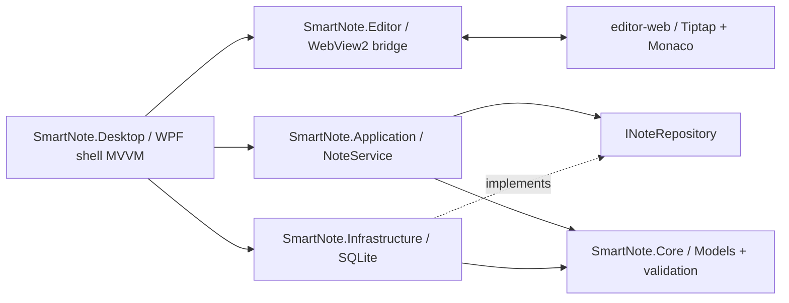

# アーキテクチャ

## 構成

| モジュール | 責務 |
|---|---|
| Core | Note、NoteTask、Preferences、チェック項目抽出、JSON/画像参照検証 |
| Application | NoteService、ITaskRegistrationPolicy、INoteRepository。AI・同期・通知はインターフェースのみ |
| Infrastructure | SQLite接続・トランザクション・履歴・オンラインバックアップ・添付ファイル |
| Editor | 仮想ホスト、メッセージ境界、外部遷移拒否、プロセス異常検出 |
| Desktop | WPFウィンドウ、ShellViewModel、ピン、トレイ、ホットキー、単一起動、クイックメモ |
| editor-web | 日本語UI、タブ状態、編集用表現、Tiptap/Monaco、dirty世代と保存キュー |
| Tests | 実SQLiteを使用するxUnit結合試験 |

WPFの最前面・ステータス・設定表示はShellViewModelへバインドしています。OSイベントとWebView2ライフサイクルはコードビハインドです。ノート/タスク画面はWebView内で描画し、保存ロジックはC#へ委譲します。Web側は軽量な状態管理で、全面的なWPF ViewModel化は行っていません。

## 正本と編集の契約

1. `Note.Document`（JSONオブジェクト）だけが正本。
2. ノートモードはTiptapのJSONを扱う。チェック項目にUUIDを補完し、複製による重複IDだけを再発行する。
3. 表示設定の変更では更新イベントを出さない。`setContent`も`emitUpdate:false`で実行する。
4. 読込時に元JSONの全キーがTiptapの出力に保持されるか比較する。末尾の空段落など追加は許容するが、既存要素の欠落・変更があればノート側を読み取り専用にする。
5. テキストモードは正本の深いコピーを基準に、本文とチェック状態への限定パッチを生成する。構造行・トークン・行数を検証し、全検証に成功したときだけ新JSONを返す。
6. 画像・未知ノード・独自属性は再構築せずコピーに保持する。通常のMarkdownパーサーへ渡さない。
7. 不正なテキストは保存・ノート復帰・画面移動を止め、元JSONと入力バッファを保持する。

空の段落/見出し/コードブロックは既存ノード内に最初のtext子を追加可能です。既存textの空文字化はProseMirrorの無効ノードを作るため拒否します。ノード削除はノートモードで実行します。

## 保存・競合・タスク

- ノートはID・タイトル・本文JSON・revision・created・updated・quickフラグを持つ。
- tasksはID、note_id、block_id、name、completed、created、updated、revision、due、recurrenceを持つ。`UNIQUE(note_id, block_id)`が冪等性を担保する。
- historyは上書き前のノートJSON・タイトルを `(note_id, revision)` で保持する。
- state表に設定とタブのスナップショットを格納する。
- `BEGIN` → revision照合 → 履歴コピー → ノート更新 → タスクupsert/削除 → COMMIT。
- タスク側の変更も同じトランザクション内で元ノートを読んでBlockIdを指定して更新する。
- 削除されたチェック項目は派生タスクも削除する。再保存・並び替えはタスクIDを変えない。
- SQLiteの非同期APIは実質同期I/Oとなるため、接続からトランザクション終了まで`Task.Run`に置き、`SemaphoreSlim`で同一リポジトリの処理を直列化する。UIスレッドへSQLite I/Oを置かない。
- Web側の保存キューとdirty世代番号により、保存待ちの間の新編集を保存済みと誤判定しない。
- タスク一覧からの更新中はコンテンツを一時操作不可にして、flush→更新→正本再取得の途中で編集を上書きしない。
- 約1秒のデバウンスとCtrl+S。完全終了はWeb・クイックメモ双方の保存成功を確認する。

## 添付と復旧

GUIDの管理ファイル名だけを生成し、ユーザー入力のパスを受け取らない。サイズ・PNG/JPGシグネチャを確認後に非同期コピーし、成功した場合だけ参照を返す。保存時に画像参照のhost/path/IDおよび管理ファイルの存在を検証する。元画像は変更しない。

DBはWALとforeign_keysを有効化。起動時quick_check、起動・正常終了時にSQLite Backup APIを使用。DBだけの単純な実行中コピーはしない。バックアップDBとは別に画像フォルダを保持する。履歴復元は現時点では管理作業でありUIはない。

## WebView2の境界

- `https://app.smartnote.local/index.html` → 実行フォルダのEditorWeb
- `https://media.smartnote.local/<GUID>.img` → ユーザー管理画像フォルダ
- `DenyCors`指定で仮想ホストを割当て、許可したページ以外の遷移・フレーム・新規ウィンドウ・ダウンロード・パーミッションを拒否する。
- CSPでスクリプトは同梱のみ、画像は管理画像ホストのみ、connect-srcはnone。
- UUIDのrequest id、command allowlist、送信元、JSON深度・サイズを検証。本文をログ出力しない。DOMにはtextContentを使用。
- 応答は同じrequest idを返す。失敗メッセージは本文を含む例外詳細ではなく、管理された理由または例外型のみ。
- ProcessFailed時は自動リロードしない。明示的な確認後、WebView2コントロールを作り直して保存済みデータから再開する。

## Windows連携

- ユーザーSIDを含むLocal MutexとCurrentUserOnlyの名前付きパイプで二重起動防止/表示要求。
- WPF WindowChromeのタイトルバーにピンと最小化・最大化・閉じるボタン。
- NotifyIconはプロセス生存中保持。×はHide、完全終了だけApplication.Shutdown。
- RegisterHotKeyで設定したキー（初期Ctrl+Alt+M）を登録。QuickShortcutがキーを検証し、ShortcutControllerが新キーの仮登録→設定保存→旧キー解除を管理する。競合/保存失敗では旧キーを維持。無効化も保存成功後に解除する。登録解除とトレイ破棄はOnExit。
- サインイン起動はHKCU Run。初期OFF、登録時は実行exeの絶対パスを引用符で囲む。
- クイックメモは独立WPFウィンドウと独立Topmost設定。通常NoteモデルにIsQuickフラグを付けて保存する。
